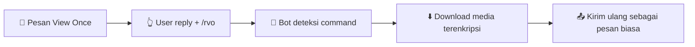

# 📖 Read-View-Once

<p align="center">
  <b>Bot WhatsApp pembuka media sekali-lihat (foto, video, audio).</b><br/>
  Reply pesan view-once dengan <code>/rvo</code> → bot kirim ulang sebagai pesan biasa.
</p>

<p align="center">
  <a href="https://nodejs.org/"></a>
  <a href="https://github.com/WhiskeySockets/Baileys"></a>
  
  <a href="./LICENCE"></a>
  
</p>

<p align="center">
  <code>/rvo</code> · <code>/viewonce</code> · <code>/readviewonce</code> &nbsp;—&nbsp; 🖼️ gambar · 🎬 video · 🎧 audio
</p>

<p align="center">
  🌍 <a href="./README.md">English</a> · <b>Bahasa Indonesia</b> (file ini)
</p>

---

## 📑 Daftar Isi

- [✨ Fitur](#-fitur)
- [⚙️ Cara Kerja](#️-cara-kerja)
- [💬 Contoh Pemakaian](#-contoh-pemakaian)
- [🧰 Persyaratan](#-persyaratan)
- [🚀 Instalasi](#-instalasi)
- [🔗 Menghubungkan Bot](#-menghubungkan-bot)
- [🎮 Cara Penggunaan](#-cara-penggunaan)
- [📁 Struktur Proyek](#-struktur-proyek)
- [🔧 Konfigurasi](#-konfigurasi)
- [🧾 Logs](#-logs)
- [❓ Troubleshooting & FAQ](#-troubleshooting--faq)
- [🔒 Keamanan & Etika](#-keamanan--etika)
- [🤝 Berkontribusi](#-berkontribusi)
- [📜 Kode Etik](#-kode-etik)
- [🛡️ Kebijakan Keamanan](#️-kebijakan-keamanan)
- [📄 Lisensi](#-lisensi)
- [👤 Author](#-author)

---

## ✨ Fitur

| Fitur | Detail |
|---|---|
| 👁️ Buka View Once | Gambar, video, dan audio sekali-lihat dikirim ulang sebagai pesan biasa |
| ⌨️ 3 Command | `/rvo`, `/viewonce`, `/readviewonce` — cukup reply ke pesan view-once |
| 👥 Multi-user | Siapa pun di chat bisa memakai command (privat, grup, saluran) |
| 🤫 Anti-berisik | Tanpa command = diam. Command salah = diam. Bukan reply view-once = diam |
| 🔳 QR & 🔢 Pairing | Pilih metode koneksi langsung dari menu terminal interaktif |
| 💾 Sesi persisten | Auth tersimpan di `session/` — restart server tanpa scan ulang |
| 🎨 Terminal elegan | Banner ASCII, menu rapi, log berwarna + timestamp |
| 📝 File log | Semua aktivitas tercatat di `logs.txt` |
| 📦 Tanpa DB | Nol database, nol config rumit — clone, install, jalan |

---

## ⚙️ Cara Kerja



1. Seseorang mengirim media **sekali-lihat** ke chat.
2. **Reply** pesan itu dengan `/rvo` (atau `/viewonce` / `/readviewonce`).
3. Bot mengunduh media via Baileys (`downloadContentFromMessage`).
4. Bot mengirim ulang media sebagai **gambar / video / audio biasa** di chat yang sama.

> ℹ️ Bot hanya bereaksi pada pesan teks yang isinya persis salah satu dari tiga command. Selebihnya diabaikan total — tanpa balasan, tanpa reaksi.

---

## 💬 Contoh Pemakaian

```
Pengirim  : [📷 Foto sekali-lihat]
Kamu      : ↩️ reply foto → "/rvo"
Bot       : [📷 Foto biasa — bisa dibuka berkali-kali] ✅
```

Media yang didukung:

- 🖼️ **Gambar** → dikirim ulang + caption asli (jika ada)
- 🎬 **Video** → dikirim ulang + caption asli (jika ada)
- 🎧 **Audio / VN** → dikirim ulang (status voice-note dipertahankan)

---

## 🧰 Persyaratan

- **Node.js** `>= 20` — cek dengan `node -v`
- **npm** — bawaan Node.js
- **Akun WhatsApp** aktif di HP untuk scan QR / pairing
- **Internet** stabil di server & HP

---

## 🚀 Instalasi

### 1️⃣ Clone repository

```bash
git clone https://github.com/ReyLanTra/Read-View-Once.git
cd Read-View-Once
```

### 2️⃣ Install dependensi

**Windows (PowerShell):**

```powershell
npm.cmd install
```

**Linux / macOS / Termux:**

```bash
npm install
```

### 3️⃣ Jalankan bot

```bash
npm start
# atau
node index.js
```

Saat pertama kali jalan tanpa sesi tersimpan, muncul menu:

```
  METODE KONEKSI
  ──────────────────────────────────────────────────
   [1]  Scan QR            — cepat, tanpa nomor
   [2]  Pairing Code       — tautkan via kode 8 digit
  ──────────────────────────────────────────────────
  ➜ Pilih metode [1/2, default 1]:
```

Jika folder `session/` sudah ada isinya → bot langsung connect, menu dilewati.

### 🐳 Docker (opsional)

```dockerfile
# Contoh Dockerfile minimal
FROM node:20-alpine
WORKDIR /app
COPY package*.json ./
RUN npm install --omit=dev
COPY . .
CMD ["node", "index.js"]
```

```bash
docker build -t read-view-once .
docker run -it -v ./session:/app/session -v ./logs.txt:/app/logs.txt read-view-once
```

> Mount volume `session/` agar tidak perlu scan ulang tiap restart container.

---

## 🔗 Menghubungkan Bot

### Opsi A — Scan QR (paling mudah)

1. Jalankan `npm start`, pilih `[1]`.
2. QR muncul di terminal.
3. Di HP: **WhatsApp → ⋮ → Perangkat Tertaut → Tautkan Perangkat**.
4. Scan QR tersebut.
5. Terminal tampil `OK Terhubung sebagai 628xx...`.

### Opsi B — Pairing Code (tanpa scan)

1. Jalankan `npm start`, pilih `[2]`.
2. Masukkan nomor WA bot format internasional tanpa `+`, contoh `62812xxxxxxx`.
3. Kode 8 digit muncul, contoh `╔══ Pairing Code: ABCD1234 ══╗`.
4. Di HP: **WhatsApp → Perangkat Tertaut → Tautkan dengan nomor telepon**.
5. Masukkan kode sebelum kedaluwarsa (±60 detik — jalankan ulang untuk kode baru).

**Shortcut non-interaktif** (untuk server / script):

```powershell
# Windows
node index.js --pairing 62812xxxxxxx
$env:PAIRING_NUMBER="62812xxxxxxx"; npm.cmd run pairing
```

```bash
# Linux / macOS
node index.js --pairing 62812xxxxxxx
PAIRING_NUMBER=62812xxxxxxx npm run pairing
```

### 💾 Sesi tersimpan

- Auth ada di folder `session/` (jangan dihapus sembarangan, jangan di-commit — sudah ada di `.gitignore`).
- Restart server / `npm start` ulang → langsung connect.
- Ganti akun / sesi rusak / logout → kosongkan `session/` lalu hubungkan ulang.

---

## 🎮 Cara Penggunaan

| Command | Fungsi |
|---|---|
| `/rvo` | Buka media sekali-lihat yang di-reply (pendek, cepat) |
| `/viewonce` | Alias — sama persis |
| `/readviewonce` | Alias — sama persis |

**Langkah:**

1. Cari pesan view-once (ikon `1️⃣` / sekali-lihat).
2. **Reply** pesan itu.
3. Ketik salah satu command di atas, kirim.
4. Bot kirim ulang medianya di chat yang sama.

**Aturan main:**

- ✅ Bisa dipakai siapa pun (bukan cuma nomor bot).
- ✅ Berlaku di chat pribadi, grup, dan saluran.
- 🔇 Pesan tanpa command → diabaikan.
- 🔇 Typo seperti `/rvoo`, `/rv`, `rvo` → diabaikan (tanpa balasan error).
- 🔇 Command tanpa reply view-once yang valid → diabaikan.

---

## 📁 Struktur Proyek

```
Read-View-Once/
├── index.js            # Seluruh logika bot (koneksi, menu, handler command)
├── package.json        # Metadata + dependensi
├── session/            # Auth WhatsApp (dibuat otomatis, JANGAN di-commit)
├── logs.txt            # Log aktivitas (dibuat otomatis saat bot jalan)
├── .gitignore          # Mengecualikan session/, logs.txt, node_modules/
├── LICENCE             # Lisensi MIT
├── CODE_OF_CONDUCT.md  # Aturan komunitas
├── CONTRIBUTING.md     # Cara berkontribusi
├── SECURITY.md         # Kebijakan keamanan
├── README.md           # Dokumen Inggris
└── README.id.md        # File ini (Indonesia)
```

**Dependensi utama:**

| Paket | Peran |
|---|---|
| `@whiskeysockets/baileys` | Koneksi WhatsApp Web Socket |
| `pino` | Logger internal Baileys (dibisukan, log custom dipakai) |
| `qrcode-terminal` | Render QR di terminal |

---

## 🔧 Konfigurasi

| Variabel / Argumen | Fungsi | Contoh |
|---|---|---|
| `--pairing 628xx` | Langsung mode pairing tanpa menu | `node index.js --pairing 62812xxxxxxx` |
| `PAIRING_NUMBER=628xx` | Sama via environment variable | `PAIRING_NUMBER=62812xxxxxxx npm start` |
| `npm start` | Jalankan bot (interaktif) | `npm start` |
| `npm run pairing` | Shortcut pairing | `npm run pairing` |

Jalan 24/7 di VPS? Gunakan `pm2`:

```bash
npm install -g pm2
pm2 start index.js --name rvo
pm2 save
pm2 logs rvo
```

---

## 🧾 Logs

Setiap aktivitas tampil di terminal (berwarna + timestamp) **dan** tersimpan di `logs.txt` (polos, tanpa kode warna).

Contoh:

```
[29/09/2026 03:10:01] [INFO] Menghubungkan ke WhatsApp...
[29/09/2026 03:10:05] [OK] Terhubung sebagai 62812xxxxxxx. Menunggu pesan berisi cmd...
[29/09/2026 03:11:20] [CMD] /rvo dari Budi (6288xxxx) di Grup 120363xxxx
[29/09/2026 03:11:20] [INFO] Download media sekali-lihat (gambar)...
[29/09/2026 03:11:21] [INFO] Download OK (312.4 KB). Mengirim ulang sebagai pesan biasa...
[29/09/2026 03:11:22] [OK] Terkirim ke Grup 120363xxxx.
```

Level log: `INFO` · `OK` · `CMD` · `QR` · `WARN` · `FAIL`.

> `logs.txt` membesar seiring waktu. Hapus / arsipkan berkala bila perlu. Jangan commit ke repo publik (berisi nama & nomor pengirim).

---

## ❓ Troubleshooting & FAQ

<details>
<summary><b>QR tidak muncul / langsung error</b></summary>

- Hapus sesi basi: kosongkan `session/`, jalankan ulang.
- Lebarkan terminal (QR butuh ~30 kolom).
- Coba mode pairing code.
</details>

<details>
<summary><b>Pairing code kedaluwarsa / gagal</b></summary>

- Kode hanya berlaku ±60 detik. Jalankan ulang untuk kode baru.
- Format nomor harus `628xx` (tanpa `+`, spasi, atau `-`).
- Nomor harus akun WA aktif.
</details>

<details>
<summary><b>Bot tidak merespons <code>/rvo</code></b></summary>

- Wajib **reply** ke pesan view-once, bukan kirim command saja.
- Command harus persis: `/rvo`, `/viewonce`, atau `/readviewonce` (huruf kecil, tanpa spasi tambahan).
- Media view-once yang sudah dibuka / kedaluwarsa kadang gagal diunduh — coba media lain.
</details>

<details>
<summary><b><code>Connection closed / reconnect loop</code></b></summary>

- Normal bila internet putus — bot reconnect otomatis tiap 3 detik.
- Bila tertulis **logout**: kosongkan `session/` dan tautkan ulang.
</details>

<details>
<summary><b><code>npm install</code> gagal di Windows</b></summary>

- Gunakan `npm.cmd install` di PowerShell (bila `npm` diblokir execution policy).
- Pastikan Node.js ≥ 20: `node -v`.
</details>

<details>
<summary><b>Apakah bisa dipakai di Termux (Android)?</b></summary>

Ya:

```bash
pkg update && pkg install nodejs git -y
git clone https://github.com/ReyLanTra/Read-View-Once.git
cd Read-View-Once
npm install
npm start
```

Gunakan mode **Pairing Code** bila QR sulit di-scan dari HP yang sama.
</details>

---

## 🔒 Keamanan & Etika

> [!WARNING]
> **Gunakan hanya untuk media yang kamu berhak membukanya.** Membuka dan menyebar media sekali-lihat milik orang lain tanpa izin bisa melanggar privasi dan hukum setempat.

- Jangan commit `session/` dan `logs.txt` — keduanya berisi kredensial & data pribadi (sudah di-`.gitignore`).
- Jangan jalankan bot di perangkat publik tanpa pengawasan.
- Hormati privasi pengirim: media view-once dikirim sekali-lihat karena suatu alasan.
- Proyek ini untuk edukasi & arsip pribadi. Penyalahgunaan di luar tanggung jawab maintainer — lihat [SECURITY.md](./SECURITY.md).

---

## 🤝 Berkontribusi

Kontribusi terbuka! Lihat [CONTRIBUTING.md](./CONTRIBUTING.md) untuk alur lengkap (fork → branch → commit → PR) dan ide issue pemula.

> Menemukan bug? Buka **Issues** dengan potongan `logs.txt` yang sudah disensor + langkah reproduksi.

---

## 📜 Kode Etik

Bersikap baik dan saling menghormati. Teks lengkap: [CODE_OF_CONDUCT.md](./CODE_OF_CONDUCT.md).

---

## 🛡️ Kebijakan Keamanan

Jangan laporkan kerentanan lewat issue publik. Baca [SECURITY.md](./SECURITY.md) dulu.

---

## 📄 Lisensi

Dirilis di bawah [MIT Licence](./LICENCE) — bebas dipakai, diubah, dan disebar dengan mencantumkan atribusi.

---

## 👤 Author

Dikembangkan oleh **ReyLan** · **Ikhlas Digital Hub**

- GitHub: [@ReyLanTra](https://github.com/ReyLanTra)
- Proyek: [Read-View-Once](https://github.com/ReyLanTra/Read-View-Once)

---

<p align="center">
  ⭐ Kalau proyek ini membantu, kasih <b>star</b> di GitHub ya!<br/>
  <sub>Dibangun dengan ❤️ di atas Node.js + Baileys</sub>
</p>
