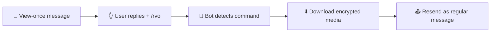

# 📖 Read-View-Once

<p align="center">
  <b>WhatsApp bot that opens view-once media (photo, video, audio).</b><br/>
  Reply to a view-once message with <code>/rvo</code> → the bot resends it as a regular message.
</p>

<p align="center">
  <a href="https://nodejs.org/"></a>
  <a href="https://github.com/WhiskeySockets/Baileys"></a>
  
  <a href="./LICENCE"></a>
  
</p>

<p align="center">
  <code>/rvo</code> · <code>/viewonce</code> · <code>/readviewonce</code> &nbsp;—&nbsp; 🖼️ image · 🎬 video · 🎧 audio
</p>

<p align="center">
  🌍 <b>English</b> (this file) · <a href="./README.id.md">Bahasa Indonesia</a>
</p>

---

## 📑 Table of Contents

- [✨ Features](#-features)
- [⚙️ How It Works](#️-how-it-works)
- [💬 Usage Example](#-usage-example)
- [🧰 Requirements](#-requirements)
- [🚀 Installation](#-installation)
- [🔗 Connecting the Bot](#-connecting-the-bot)
- [🎮 Usage](#-usage)
- [📁 Project Structure](#-project-structure)
- [🔧 Configuration](#-configuration)
- [🧾 Logs](#-logs)
- [❓ Troubleshooting & FAQ](#-troubleshooting--faq)
- [🔒 Security & Ethics](#-security--ethics)
- [🤝 Contributing](#-contributing)
- [📜 Code of Conduct](#-code-of-conduct)
- [🛡️ Security Policy](#️-security-policy)
- [📄 Licence](#-licence)
- [👤 Author](#-author)

---

## ✨ Features

| Feature | Detail |
|---|---|
| 👁️ Open View Once | View-once images, videos, and audio are resent as regular messages |
| ⌨️ 3 Commands | `/rvo`, `/viewonce`, `/readviewonce` — just reply to the view-once message |
| 👥 Multi-user | Anyone in the chat can use the commands (private, group, channel) |
| 🤫 Silent by design | No command = silence. Wrong command = silence. Not a view-once reply = silence |
| 🔳 QR & 🔢 Pairing | Pick the connection method from an interactive terminal menu |
| 💾 Persistent session | Auth stored in `session/` — restart without re-linking |
| 🎨 Elegant terminal | ASCII banner, tidy menu, colored timestamped logs |
| 📝 Log file | Every activity recorded in `logs.txt` |
| 📦 No database | Zero DB, zero complex config — clone, install, run |

---

## ⚙️ How It Works



1. Someone sends a **view-once** media to the chat.
2. **Reply** to that message with `/rvo` (or `/viewonce` / `/readviewonce`).
3. The bot downloads the media via Baileys (`downloadContentFromMessage`).
4. The bot resends it as a **regular image / video / audio** in the same chat.

> ℹ️ The bot only reacts to text messages whose content is exactly one of the three commands. Everything else is fully ignored — no reply, no reaction.

---

## 💬 Usage Example

```
Sender  : [📷 View-once photo]
You     : ↩️ reply to the photo → "/rvo"
Bot     : [📷 Regular photo — opens unlimited times] ✅
```

Supported media:

- 🖼️ **Image** → resent + original caption (if any)
- 🎬 **Video** → resent + original caption (if any)
- 🎧 **Audio / voice note** → resent (voice-note flag preserved)

---

## 🧰 Requirements

- **Node.js** `>= 20` — check with `node -v`
- **npm** — bundled with Node.js
- An active **WhatsApp** account on your phone (for QR scan / pairing)
- Stable **internet** on server & phone

---

## 🚀 Installation

### 1️⃣ Clone the repository

```bash
git clone https://github.com/ReyLanTra/Read-View-Once.git
cd Read-View-Once
```

### 2️⃣ Install dependencies

**Windows (PowerShell):**

```powershell
npm.cmd install
```

**Linux / macOS / Termux:**

```bash
npm install
```

### 3️⃣ Run the bot

```bash
npm start
# or
node index.js
```

On first run with no saved session, a menu appears:

```
  CONNECTION METHOD
  ──────────────────────────────────────────────────
   [1]  Scan QR            — fast, no number needed
   [2]  Pairing Code       — link via 8-digit code
  ──────────────────────────────────────────────────
  ➜ Choose method [1/2, default 1]:
```

If `session/` already contains auth → bot connects directly, menu skipped.

### 🐳 Docker (optional)

```dockerfile
# Minimal example Dockerfile
FROM node:20-alpine
WORKDIR /app
COPY package*.json ./
RUN npm install --omit=dev
COPY . .
CMD ["node", "index.js"]
```

```bash
docker build -t read-view-once .
docker run -it -v ./session:/app/session -v ./logs.txt:/app/logs.txt read-view-once
```

> Mount the `session/` volume so you don't re-link on every container restart.

---

## 🔗 Connecting the Bot

### Option A — QR scan (easiest)

1. Run `npm start`, choose `[1]`.
2. A QR code appears in the terminal.
3. On your phone: **WhatsApp → ⋮ → Linked Devices → Link a Device**.
4. Scan the QR.
5. Terminal shows `OK Connected as 628xx...`.

### Option B — Pairing code (no scan)

1. Run `npm start`, choose `[2]`.
2. Enter the bot's WA number in international format without `+`, e.g. `62812xxxxxxx`.
3. An 8-digit code appears, e.g. `╔══ Pairing Code: ABCD1234 ══╗`.
4. On your phone: **WhatsApp → Linked Devices → Link with phone number**.
5. Enter the code before it expires (±60 seconds — rerun for a new one).

**Non-interactive shortcut** (servers / scripts):

```powershell
# Windows
node index.js --pairing 62812xxxxxxx
$env:PAIRING_NUMBER="62812xxxxxxx"; npm.cmd run pairing
```

```bash
# Linux / macOS
node index.js --pairing 62812xxxxxxx
PAIRING_NUMBER=62812xxxxxxx npm run pairing
```

### 💾 Saved session

- Auth lives in `session/` (never delete it casually, never commit it — already in `.gitignore`).
- Restart server / rerun `npm start` → connects directly.
- Switching accounts / broken session / logged out → empty `session/` and re-link.

---

## 🎮 Usage

| Command | Function |
|---|---|
| `/rvo` | Open the replied view-once media (short, fast) |
| `/viewonce` | Alias — identical |
| `/readviewonce` | Alias — identical |

**Steps:**

1. Find a view-once message (the `1️⃣` / view-once icon).
2. **Reply** to that message.
3. Type one of the commands above, send.
4. The bot resends the media in the same chat.

**Rules:**

- ✅ Anyone can use it (not only the bot number).
- ✅ Works in private chats, groups, and channels.
- 🔇 Message without a command → ignored.
- 🔇 Typos like `/rvoo`, `/rv`, `rvo` → ignored (no error reply).
- 🔇 Command without a valid view-once reply → ignored.

---

## 📁 Project Structure

```
Read-View-Once/
├── index.js            # All bot logic (connection, menu, command handler)
├── package.json        # Metadata + dependencies
├── session/            # WhatsApp auth (auto-created, NEVER commit)
├── logs.txt            # Activity log (auto-created on run)
├── .gitignore          # Excludes session/, logs.txt, node_modules/
├── LICENCE             # MIT Licence
├── CODE_OF_CONDUCT.md  # Community rules
├── CONTRIBUTING.md     # How to contribute
├── SECURITY.md         # Security policy
├── README.md           # This file (English)
└── README.id.md        # Indonesian docs
```

**Main dependencies:**

| Package | Role |
|---|---|
| `@whiskeysockets/baileys` | WhatsApp Web Socket connection |
| `pino` | Internal Baileys logger (silenced, custom log used) |
| `qrcode-terminal` | Render QR in terminal |

---

## 🔧 Configuration

| Variable / Argument | Function | Example |
|---|---|---|
| `--pairing 628xx` | Pairing mode without menu | `node index.js --pairing 62812xxxxxxx` |
| `PAIRING_NUMBER=628xx` | Same via environment variable | `PAIRING_NUMBER=62812xxxxxxx npm start` |
| `npm start` | Run bot (interactive) | `npm start` |
| `npm run pairing` | Pairing shortcut | `npm run pairing` |

Run 24/7 on a VPS? Use `pm2`:

```bash
npm install -g pm2
pm2 start index.js --name rvo
pm2 save
pm2 logs rvo
```

---

## 🧾 Logs

Every activity shows in the terminal (colored + timestamp) **and** is saved to `logs.txt` (plain, no color codes).

Example:

```
[29/09/2026 03:10:01] [INFO] Connecting to WhatsApp...
[29/09/2026 03:10:05] [OK] Connected as 62812xxxxxxx. Waiting for command messages...
[29/09/2026 03:11:20] [CMD] /rvo from Budi (6288xxxx) in Group 120363xxxx
[29/09/2026 03:11:20] [INFO] Downloading view-once media (image)...
[29/09/2026 03:11:21] [INFO] Download OK (312.4 KB). Resending as regular message...
[29/09/2026 03:11:22] [OK] Sent to Group 120363xxxx.
```

Log levels: `INFO` · `OK` · `CMD` · `QR` · `WARN` · `FAIL`.

> `logs.txt` grows over time. Delete / archive it periodically. Never commit it to a public repo (contains sender names & numbers).

---

## ❓ Troubleshooting & FAQ

<details>
<summary><b>QR doesn't show / instant error</b></summary>

- Remove stale session: empty `session/`, rerun.
- Make the terminal wide enough (QR needs ~30 columns).
- Try pairing-code mode instead.
</details>

<details>
<summary><b>Pairing code expired / failed</b></summary>

- Codes live ±60 seconds. Rerun for a fresh one.
- Number format must be `628xx` (no `+`, spaces, or `-`).
- The number must be an active WA account.
</details>

<details>
<summary><b>Bot ignores <code>/rvo</code></b></summary>

- You must **reply** to the view-once message, not just send the command.
- Command must match exactly: `/rvo`, `/viewonce`, or `/readviewonce` (lowercase, no extra spaces).
- Already-opened / expired view-once media sometimes fails to download — try another one.
</details>

<details>
<summary><b><code>Connection closed / reconnect loop</code></b></summary>

- Normal on network drop — bot auto-reconnects every 3 seconds.
- If it says **logged out**: empty `session/` and re-link.
</details>

<details>
<summary><b><code>npm install</code> fails on Windows</b></summary>

- Use `npm.cmd install` in PowerShell (if `npm` is blocked by execution policy).
- Ensure Node.js ≥ 20: `node -v`.
</details>

<details>
<summary><b>Can I run it on Termux (Android)?</b></summary>

Yes:

```bash
pkg update && pkg install nodejs git -y
git clone https://github.com/ReyLanTra/Read-View-Once.git
cd Read-View-Once
npm install
npm start
```

Use **Pairing Code** mode if QR is hard to scan from the same phone.
</details>

---

## 🔒 Security & Ethics

> [!WARNING]
> **Only open media you have the right to open.** Opening and spreading someone else's view-once media without consent may violate privacy and local law.

- Never commit `session/` or `logs.txt` — both hold credentials & personal data (already in `.gitignore`).
- Don't run the bot on public devices unsupervised.
- Respect senders: view-once was sent once for a reason.
- This project is for education & personal archiving. Misuse is the user's responsibility — see [SECURITY.md](./SECURITY.md).

---

## 🤝 Contributing

Contributions welcome! See [CONTRIBUTING.md](./CONTRIBUTING.md) for the full workflow (fork → branch → commit → PR) and good-first-issue ideas.

> Found a bug? Open an **Issue** with a redacted `logs.txt` excerpt + reproduction steps.

---

## 📜 Code of Conduct

Be kind, be respectful. Full text: [CODE_OF_CONDUCT.md](./CODE_OF_CONDUCT.md).

---

## 🛡️ Security Policy

Do **not** report vulnerabilities via public issues. Read [SECURITY.md](./SECURITY.md) first.

---

## 📄 Licence

Released under the [MIT Licence](./LICENCE) — free to use, modify, and share with attribution.

---

## 👤 Author

Developed by **ReyLan** · **Ikhlas Digital Hub**

- GitHub: [@ReyLanTra](https://github.com/ReyLanTra)
- Project: [Read-View-Once](https://github.com/ReyLanTra/Read-View-Once)

---

<p align="center">
  ⭐ If this project helps you, please give it a <b>star</b> on GitHub!<br/>
  <sub>Built with ❤️ on Node.js + Baileys</sub>
</p>
